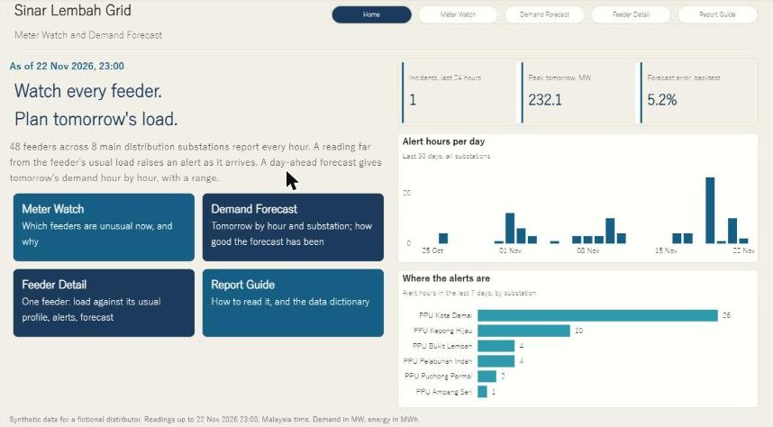

# Grid demand forecast and meter watch: a Microsoft Fabric estate

An electricity distributor's 48 feeders report demand every hour. Readings that are far from a feeder's usual load raise an
alert as they arrive, and a day-ahead forecast gives tomorrow's demand hour by hour, with a range. One Fabric workspace does
both: an Eventhouse scores each hourly batch with KQL update policies, notebooks build the Gold tables and train the
forecast, a pipeline runs them with a verdict gate after each step, and a Direct Lake report shows the result.

**Sinar Lembah Grid Sdn Bhd is a fictional distributor in the Klang Valley and all data is synthetic.** A deterministic
generator writes 13 months of hourly load (455,040 readings), plants spikes, drops, stuck meters and slow drifts for the
detector to find, and logs planned load transfers between feeders. There is no live link: the repository builds the whole
workspace in yours.

**Rebuild guide:** https://biventure2025.github.io/sinar-lembah-grid-forecast/docs/guide.html



## What it does

| Part | How |
|---|---|
| Meter watch | Each reading is scored against the feeder's usual load for that hour and day type (median of the 12 weeks before). Five typical spreads above or below, or six equal readings in a row, raise an alert. Alerts in back-to-back hours form an incident; a planned load transfer in the switching log explains it |
| Detector check | The generator's planted events are the answer key. Only events that ended a day before the cut-off are graded, and planted windows moved one week later act as a control that should draw no alerts |
| Forecast | Gradient boosting on last day, same hour last week, the 4-week mean, hour, day type, public holidays and the temperature forecast. Nine weekly refit folds; it must beat "same hour last week" with a 95% interval above zero, or the benchmark is used instead |
| Delivery | Everything is a Fabric Git-format folder in `fabric/`. A new workspace is built from the repository in three Bulk Import waves, and a deployment plan runs the seed notebook as its post-action |

## Results

- Detector: 15 of 16 matured planted events caught (the miss is a weak drop), 0 alerts in 8 control windows.
- Forecast over the 9-week backtest: 5.17% error against 7.82% for same hour last week; gain 2.65 points, 95% interval 1.81 to 3.56. AutoML (FLAML) on the last fold did not beat it.
- The forecast range is narrower than its 80% target: it held 72% of hours in the last three backtest weeks, and the report says so.
- Built from the repository into an empty workspace: 9 of 9 items, 0 development ids left, 455,040 readings with the same total as the original.

## What is in the repository

| Folder | What is in it |
|---|---|
| `fabric/` | The Fabric items: Eventhouse and KQL database, Lakehouse with 8 shortcuts, three notebooks, the pipeline, the Direct Lake model, the report, a Variable Library and `parameter.yml` |
| `src/` | The generators: the Python oracle of the data generator, the KQL scripts, the notebook modules with offline tests, and the builders of the estate, the model and the report |
| `kit/` | Helpers the builders and checks use: PBIR visual primitives, the statistics check, the fabric-cicd deploy wrapper |
| `tools/` | `plan_create.py`: builds an empty workspace from this repository in Bulk Import waves with a deployment plan |
| `docs/` | The rebuild guide, build record, model card, brief, design package, mockup and next version |

## Rebuild

In short: create an empty Fabric workspace on a capacity, sign in with `az login`, then

```bash
git clone https://github.com/BIVenture2025/sinar-lembah-grid-forecast.git
TARGET_WORKSPACE_ID=<your empty workspace id> python tools/plan_create.py sinar-lembah-grid-forecast
```

The seed notebook generates the data, then run `PL_SinarLembah_Daily` and refresh `SM_SinarLembah`. The guide has every step,
the checks and the traps.

## Licence

MIT. Built by Yeong Wai Son, Kuala Lumpur. Contact: waisonyeong@gmail.com
